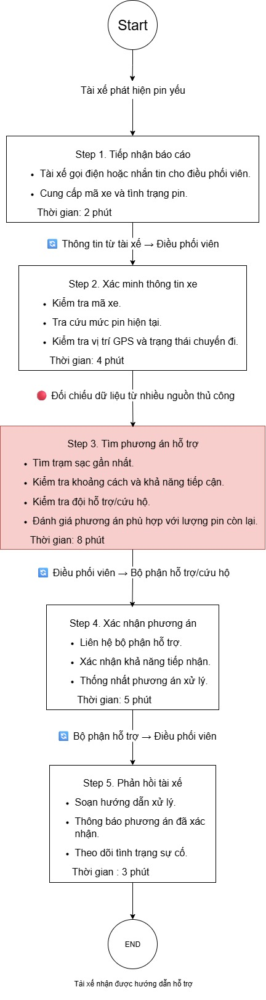
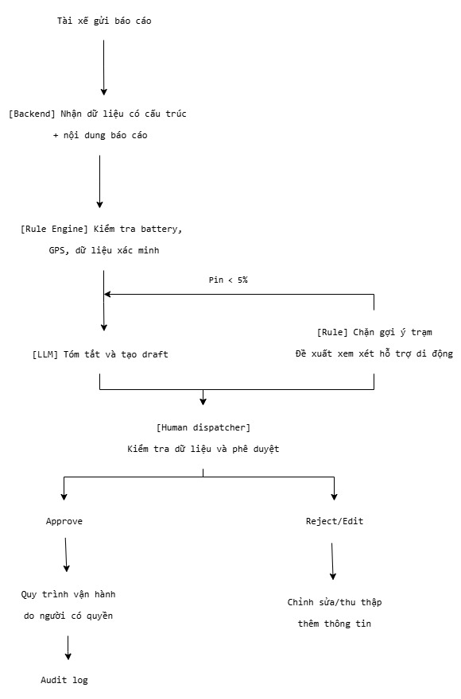

# Lab 02 — Worksheet: AI Product Scoping (Vin Smart Future)

---

## 🏛️ 1. Bối cảnh thực tế: Vin Smart Future (Vingroup)

**Vingroup** — Tập đoàn tư nhân lớn nhất Việt Nam — vừa sáp nhập toàn bộ các phòng ban công nghệ thuộc các công ty thành viên thành một đơn vị công nghệ thống nhất mang tên **Vin Smart Future**. 

Nhiệm vụ của **Vin Smart Future** là xây dựng các giải pháp AI, số hóa, và tự động hóa cốt lõi để nâng cao hiệu suất vận hành và trải nghiệm khách hàng xuyên suốt các công ty thành viên:
* 🚗 **VinFast:** Hệ thống xe điện thông minh (EV), trợ lý AI ảo trong xe, dự đoán bảo trì pin, và quản lý chuỗi cung ứng sản xuất.
* 🚕 **Xanh SM (GSM):** Vận hành đội xe taxi/xe máy điện thông minh, điều vận thông minh (Smart Dispatching), tối ưu hóa lộ trình di chuyển.
* 🏢 **Vinhomes:** Quản lý đô thị thông minh (Smart Cities), trợ lý cư dân thông minh, tối ưu hóa mức tiêu thụ năng lượng.
* 🏥 **Vinmec:** Y tế thông minh, chẩn đoán hình ảnh bằng AI, tối ưu hóa quản lý hồ sơ bệnh án.
* 🎢 **Vinpearl / VinWonders:** Trải nghiệm du lịch số hóa, quản lý phòng và luồng khách thông minh tại các khu vui chơi.

Trong buổi Lab hôm nay, nhóm của bạn sẽ đóng vai trò là **AI Product Engineer** tại **Vin Smart Future**, tiến hành tìm kiếm, scoping, phân tích độ khả thi, thiết lập ranh giới vận hành, và xây dựng một **bản mẫu kỹ thuật (prompt prototype)** cho một bài toán cụ thể thuộc một trong những mảng kinh doanh trên.

---

## 📊 2. Cơ cấu tính điểm bài lab

### 👥 Điểm nhóm (60 điểm)

| Gate | Điểm | Deliverable | Tiêu chí chấm |
|---|---:|---|---|
| **G1. Workflow Mapping** | 20 | Problem Deep-Dive | Vẽ chi tiết quy trình hiện tại: các bước, handoff, thời gian, bottleneck |
| **G2. Problem Statement** | 20 | Problem Deep-Dive | Problem Statement 6-field bám sát thực tế, metric có số và ranh giới rõ ràng |
| **G3. AI Fit & Future Flow** | 10 | Problem Deep-Dive | So sánh Rule vs LLM vs Agent, future flow có bước AI, ranh giới và Fallback |
| **G4. Decision Quality** | 10 | Problem Deep-Dive | Quyết định Go/Not Yet/No-Go trung thực và có chứng cứ rõ ràng |

### 👤 Điểm cá nhân (40 điểm)

| Gate | Điểm | Deliverable | Tiêu chí chấm |
|---|---:|---|---|
| **I1. Scan & Cards** | 15 | Quick Cards | Liệt kê 5 problems sử dụng 3 lenses, hoàn thiện 3 quick cards chất lượng |
| **I2. Prototyping** | 10 | 02-lab/ | Chạy thử nghiệm programmatic prompt prototype thành công |
| **I3. AI Log & Reflection** | 15 | 03-ai-log.md | Phản ánh trung thực về việc dùng AI làm thought-partner (giúp gì, sai gì, sửa gì) |

---

# 🚀 Phase 0 — worked Example: Xanh SM Intelligent Dispatcher (15 min)

*Giảng viên walk-through ví dụ thực tế từ Vin Smart Future để bạn hiểu rõ cách scoping một bài toán AI.*
Đọc chi tiết worked example tại file [02-deliverable-example.md](02-deliverable-example.md).

---

# 🔍 Phase 1 — SCAN (Cá nhân, 20 min)

Hãy sử dụng **4 Lenses** dưới đây để quét qua hoạt động vận hành của các công ty thành viên Vingroup. Ghi lại **ít nhất 5 bài toán/bottleneck** thực tế.

### 4 Lenses tìm bài toán AI cho Vingroup:
1. **Lặp lại (Repetitive):** Tác vụ lặp đi lặp lại nhiều lần hằng ngày. (Ví dụ: So khớp hóa đơn sạc điện tại VinFast, route lại chuyến taxi tại Xanh SM).
2. **Tốn thời gian (Time-consuming):** Tác vụ ngốn thời gian xử lý thủ công của nhân viên. (Ví dụ: Soạn thảo phản hồi đánh giá 1-star của cư dân Vinhomes).
3. **AI có thể tốt hơn (AI-upgrade):** Dịch vụ khách hàng hiện tại còn chậm hoặc phản hồi rập khuôn. (Ví dụ: Chatbot CSKH Vinpearl hỗ trợ đặt vé vui chơi).
4. **Pain từ người khác (Stakeholder Pain):** Bottleneck khiến khách hàng hoặc nhân viên thực địa phàn nàn. (Ví dụ: Tài xế Xanh SM phàn nàn về việc hệ thống gợi ý điểm đón khách không chính xác).

> [!TIP]
> **🤖 AI Prompts — Partner brainstorm:**
> Hãy sử dụng prompt sau để brainstorm các bài toán thực tế nếu bạn chưa có ý tưởng:
> *"Tôi là AI Engineer tại Vin Smart Future (Vingroup). Tôi đang tìm kiếm các pain point vận hành cụ thể có thể tối ưu bằng AI cho mảng [Chọn một: VinFast / Xanh SM / Vinhomes / Vinmec]. Hãy gợi ý cho tôi 5 quy trình nghiệp vụ thủ công, tốn nhiều thời gian và gây rò rỉ hiệu suất kèm con số thống kê ước tính về tổn thất."*

### 📝 List bài toán của tôi:
| # | Subsidiary (VinFast/Xanh SM...) | Lens | Mô tả ngắn bài toán |
|---|----------------------------------|------|---------------------|
| 1 | Xanh SM | Repetitive, Time-consuming | Điều phối viên phải đọc thông tin pin, vị trí, trạng thái chuyến đi và tìm phương án hỗ trợ cho xe điện pin yếu. |
| 2 | Xanh SM | AI-upgrade, Stakeholder Pain | Soạn phản hồi cho tài xế/khách hàng khi có sự cố như xe hết pin, trễ chuyến, điểm đón sai; nội dung hiện có thể chậm hoặc thiếu nhất quán. |
| 3 | Xanh SM | Repetitive, Time-consuming | Phân loại phản ánh của khách hàng theo nhóm: thái độ tài xế, vệ sinh xe, trễ chuyến, thanh toán, an toàn. |
| 4 | VinFast | Repetitive, Time-consuming | Tổng hợp mô tả lỗi xe từ đại lý/call center và phân loại để chuyển đúng bộ phận kỹ thuật.
| 5 | Vinhomes | Time-consuming, Stakeholder Pain | Phân loại phản ánh cư dân và soạn bản nháp phản hồi cho ban quản lý theo loại sự cố và mức độ ưu tiên. |

---

# 🃏 Phase 2 — QUICK-ASSESS (Cá nhân, 30 min)

Chọn **top 3 bài toán** từ danh sách trên và hoàn thiện **3 Quick Problem Cards** dưới đây (10 phút/card).

```
┌─────────────────────────────────────────────────────────────┐
│ QUICK PROBLEM CARD #1 - Hỗ trợ xe điện pin nguy cấp         │
│                                                             │
│ Bài toán (1 câu): Điều phối viên cần nhanh chóng xác định   |
| hướng xử lý an toàn khi tài xế Xanh SM báo xe có mức pin    |
| rất thấp.                                                   │
|                                                             |
│ Công ty thành viên: [ ] VinFast  [X] Xanh SM  [ ] Vinhomes  │
│                     [ ] Vinmec   [ ] Khác (Ghi rõ)________  │
│                                                             │
│ Ai đang đau (Actor)? Điều phối viên, tài xế                 │
│                                                             │
│ Workflow thủ công hiện tại (3-5 bước):                      │
│   1. Nhận cuộc gọi/tin nhắn báo pin yếu                     |
|   2. Hỏi hoặc tra cứu mức pin, vị trí GPS, mã xe            |
|   và trạng thái chuyến.                                     |
|   3. Kiểm tra phương án hỗ trợ và khoảng cách               |
|   trạm sạc/đội hỗ trợ.                                      |
|   4. Trao đổi với bộ phận điều phối hoặc cứu hộ.            |
|   5. Soạn phản hồi và thông báo cho tài xế.                 |
│                                                             │
│ Bước nào tốn thời gian/lỗi nhất? 3 (⏱ 5-10 phút/lượt)       │
│ AI có thể nhảy vào hỗ trợ ở bước nào? Tóm tắt nội dung báo  | 
| sự cố, trích xuất thông tin có trong yêu cầu và tạo         |
| bản nháp phản hồi.                                          │
│                                                             │
│ Đo thành công bằng gì (Metric có số)?                       |
|  1. Giảm thời gian tạo bản nháp từ baseline giả định 5–10   |
| phút xuống dưới 2 phút                                      |
|  2. 100% trường hợp pin dưới 5% không được gợi ý trạm sạc   | 
|  3. 100% hành động cần người duyệt.                         │
│                                                             │
│                                                             │
│ Quick Architecture: [ ] No AI  [X] Rule  [X] LLM  [ ] Agent │
└─────────────────────────────────────────────────────────────┘

┌─────────────────────────────────────────────────────────────┐
│ QUICK PROBLEM CARD #2 - Phân loại phản ánh khách hàng       │
│                                                             │
│ Bài toán (1 câu): Tự động phân loại phản ánh khách hàng     |
| để chuyển đúng nhóm xử lý.                                  |
|                                                             |
│ Công ty thành viên: [ ] VinFast  [X] Xanh SM  [ ] Vinhomes  │
│                     [ ] Vinmec   [ ] Khác (Ghi rõ)________  │
│                                                             │
│ Ai đang đau (Actor)? Nhân viên chăm sóc khách hàng và       |
| trưởng nhóm vận hành.                                       │
│                                                             │
│ Workflow thủ công hiện tại (3-5 bước):                      │
│   1. Nhận phản ánh từ ứng dụng/call center.                 |
|   2. Đọc nội dung và xác định chủ đề.                       |
|   3. Xác định mức độ ưu tiên.                               |
|   4. Chuyển ticket đến nhóm phụ trách.                      |
|   5. Theo dõi trạng thái xử lý.                             │
│                                                             │
│ Bước nào tốn thời gian/lỗi nhất? 2 (⏱ 10-15 phút/lượt)      │
│ AI có thể nhảy vào hỗ trợ ở bước nào? Gợi ý category,       |
| priority và tóm tắt ticket; nhân viên xác nhận trước        |
| khi chuyển.                                                 │
│                                                             │
│ Đo thành công bằng gì (Metric có số)?                       |
|  1. Ít nhất 90% ticket được gợi ý đúng category trong       |
| tập kiểm thử được gán nhãn                                  |
|  2. thời gian phân loại trung vị dưới 30 giây.              │
│                                                             │
│                                                             │
│ Quick Architecture: [ ] No AI  [X] Rule  [X] LLM  [ ] Agent │
└─────────────────────────────────────────────────────────────┘

┌─────────────────────────────────────────────────────────────┐
│ QUICK PROBLEM CARD #3 - Soạn phản hồi sự cố cho tài xế      │
│                                                             │
│ Bài toán (1 câu): Tạo bản nháp phản hồi ngắn gọn, nhất quán |
| cho tài xế khi phát sinh sự cố vận hành.                    |
|                                                             |
│ Công ty thành viên: [ ] VinFast  [X] Xanh SM  [ ] Vinhomes  │
│                     [ ] Vinmec   [ ] Khác (Ghi rõ)________  │
│                                                             │
│ Ai đang đau (Actor)? Nhân viên điều phối và chăm sóc tài xế.│
│                                                             │
│ Workflow thủ công hiện tại (3-5 bước):                      │
│   1. Nhận thông tin sự cố.                                  |
|   2. Kiểm tra dữ liệu liên quan.                            |
|   3. Tìm mẫu phản hồi phù hợp.                              |
|   4. Chỉnh sửa nội dung theo tình huống.                    |
|   5. Gửi sau khi được duyệt.                                │
│                                                             │
│ Bước nào tốn thời gian/lỗi nhất? Viết lại nội dung và       |
| bảo đảm không đưa ra cam kết hoặc thông tin chưa xác minh.  │
│ AI có thể nhảy vào hỗ trợ ở bước nào? Soạn bản nháp dựa     |
| trên dữ liệu đã xác minh, không tự gửi.                     │
│                                                             │
│ Đo thành công bằng gì (Metric có số)?                       |
|  1. 90% bản nháp được nhân viên chấp nhận sau tối đa        |
| một lần chỉnh sửa                                           |
|  2. Không có bản nháp nào tự động được gửi.                 │
│                                                             │
│                                                             │
│ Quick Architecture: [ ] No AI  [X] Rule  [X] LLM  [ ] Agent │
└─────────────────────────────────────────────────────────────┘
```

> [!TIP]
> **🤖 AI Prompts — Stress-Test thẻ bài toán:**
> Hãy dán nội dung thẻ bài toán của bạn vào LLM để nhận phản biện:
> *"Đây là một thẻ bài toán vận hành tôi đề xuất cho Vin Smart Future: [Dán nội dung]. Hãy đóng vai trò là một CFO và Trưởng phòng Vận hành cực kỳ khắt khe, chỉ ra cho tôi 3 điểm yếu về logic, metric, và giải thích vì sao rule-based code thông thường có thể giải quyết bài toán này tốt hơn là dùng AI."*

---

# 🏗️ Phase 3 — DEEP-DIVE (Nhóm, 85 min)

## 3.1. Current-State Workflow Mapping (25 min)
**Vẽ quy trình hiện tại lên bảng/giấy A3.** Sử dụng các ký hiệu:
* 🔴 **Bottleneck:** Bước gây tắc nghẽn, tốn thời gian, hoặc sai sót nhiều nhất.
* 🔄 **Handoff:** Điểm chuyển giao thông tin giữa người và hệ thống, hoặc giữa các bộ phận.
* Ghi rõ thời gian vận hành trung bình: **Tổng cộng = ____ phút/lượt**.



**Tổng cộng = 22 phút/lượt**

## 3.2. Problem Statement (6-field) & Metrics (15 min)
Điền đầy đủ 6 trường thông tin của bài toán:

| Field | Nội dung chi tiết |
|---|---|
| **1. Actor / Operator** | Điều phối viên Xanh SM tiếp nhận và xử lý báo cáo xe điện pin yếu từ tài xế. |
| **2. Current Workflow** | Tiếp nhận tin nhắn/cuộc gọi → hỏi thông tin xe, pin và vị trí → tra cứu trạm sạc/đội hỗ trợ → chọn phương án → trao đổi với bộ phận liên quan → soạn phản hồi và theo dõi. |
| **3. Bottleneck** | Thông tin đầu vào không đồng nhất; phải đối chiếu nhiều nguồn; nguy cơ đề xuất trạm sạc không phù hợp khi pin nguy cấp. |
| **4. Business Impact** | Có thể làm tăng thời gian xử lý sự cố, kéo dài thời gian gián đoạn hoạt động của xe, ảnh hưởng trải nghiệm tài xế/khách hàng và tăng tải cho điều phối viên. Cần thu thập log để định lượng chi phí thực tế. |
| **5. Success Metric** | Pilot đề xuất: giảm thời gian tạo bản nháp xuống dưới 2 phút; 100% tình huống pin <5% bị chặn gợi ý trạm sạc; 100% phản hồi ở trạng thái draft và cần người duyệt; tỷ lệ JSON hợp lệ ≥99% trên bộ test. Các ngưỡng là mục tiêu thử nghiệm, cần hiệu chỉnh theo baseline. |
| **6. Operational Boundary** | AI chỉ tóm tắt thông tin và tạo bản nháp. Không gửi tin nhắn, không điều xe, không đặt trạm, không tự xác nhận dữ liệu GPS/pin/trạm. Nếu pin <5%, backend rule phải chặn gợi ý trạm và đề xuất quy trình hỗ trợ di động để dispatcher xem xét. Nếu thiếu dữ liệu hoặc API lỗi, yêu cầu xác minh/thực hiện quy trình thủ công. Mọi hành động cần human approval. |

## 3.3. Future-State Flow & AI Fit (25 min)
* **Xác định mức AI Fit (AI-Fit Matrix):** Giải pháp thuộc nhóm nào? [ ] Rule / State-Machine [ ] LLM Feature [ ] Agentic Loop.
* **Vẽ Future-State Flow:** Đánh dấu rõ:
  * 🔵 **AI Step:** Tác vụ LLM xử lý.
  * 🟢 **Human Step (HITL):** Bước con người phê duyệt/review (Human-in-the-loop).
  * ↩️ **Fallback:** Kế hoạch dự phòng khi LLM trả về kết quả lỗi hoặc không tự tin.

**AI-Fit Matrix**
| Phương án | Vai trò | Đánh giá |
|---|---|---|
| Rule / State Machine | Kiểm tra ngưỡng pin, dữ liệu bắt buộc, khoảng cách và điều kiện cho phép | **Bắt buộc** cho các quyết định an toàn có điều kiện rõ ràng |
| LLM Feature | Hiểu nội dung tự nhiên, trích xuất thông tin được cung cấp, tóm tắt và soạn bản nháp | Phù hợp để hỗ trợ dispatcher |
| Agentic Loop | Tự gọi công cụ, tự điều phối xe hoặc gửi tin | **Không phù hợp trong scope prototype** vì có rủi ro hành động ngoài đời thực |

**Future-State Flow**  

---

# 💻 Phase 4 — TECHNICAL PROMPT PROTOTYPE (Nhóm, 30 min)

Để đảm bảo kỹ sư của Vin Smart Future luôn giữ vững năng lực lập trình, nhóm của bạn sẽ tiến hành **lập trình bản mẫu prompt** trực tiếp trên **Gemini 2.5 Flash** bằng Python để stress-test hệ thống.

### Hướng dẫn thực hiện:
1. Mở file [starter-code/prompt_prototype.py](starter-code/prompt_prototype.py) bằng VS Code/Cursor.
2. Hoàn thiện các nội dung sau:
   * **System Prompt:** Viết chỉ thị cực kỳ nghiêm ngặt quy định vai trò, nhiệm vụ, định dạng output và **Operational Boundary (Ranh giới cấm)** của mô hình.
   * **Structured Output:** Định nghĩa định dạng JSON output rõ ràng.
   * **Adversarial Test Cases:** Viết ít nhất 3 prompts "tấn công" (Adversarial inputs) cố tình dụ AI vượt ranh giới hoặc đưa ra câu trả lời không được phép để kiểm tra xem ranh giới của bạn có thực sự vững chắc.
3. Chạy file python:
   ```bash
   python3 prompt_prototype.py
   ```
4. Kiểm tra xem các ranh giới an toàn có bị LLM phá vỡ hay không và ghi lại kết quả vào worksheet.

---

# 🏁 Phase 5 — EVALUATE (Nhóm, 20 min)

### AI Readiness Checklist:
1. [ ] Chúng tôi có sẵn dữ liệu mẫu/logs sạch để test?
2. [X] Rủi ro khi AI sai có nằm trong tầm kiểm soát (qua HITL hoặc Fallback)?
3. [ ] Stakeholders sẵn sàng thay đổi quy trình làm việc cũ?

### Quyết định cuối cùng của Ban Giám Đốc Vin Smart Future:
[ ] **GO (Bắt đầu xây dựng Prototype):** Bắt đầu phát triển với scope hẹp.  
[X] **NOT YET (Cần tích lũy thêm dữ liệu/xác lập baseline):** Trì hoãn để chuẩn bị thêm.  
[ ] **NO-GO (Không khả thi / Rule-based tốt hơn):** Hủy bỏ dự án AI này.

**Justification (Lý giải quyết định dựa trên bằng chứng kỹ thuật và chi phí):**
- Bài toán có tiềm năng vì LLM có thể hỗ trợ đọc báo cáo tự nhiên, tóm tắt và tạo bản nháp nhanh.
- Quy tắc an toàn như ngưỡng pin dưới 5% có thể biểu diễn bằng code thông thường; không nên giao quyền quyết định này cho LLM.
- Chưa có dữ liệu baseline, log vận hành, tỷ lệ lỗi hiện tại hoặc xác nhận từ stakeholder để chứng minh hiệu quả kinh doanh.
- Model API có thể lỗi/quá tải; cần fallback không phụ thuộc LLM.
- Chưa đủ bằng chứng để triển khai thật. Có thể tiếp tục prototype offline với dữ liệu giả lập/đã ẩn danh, bộ test adversarial và human review.

---

# 📝 Phase 6 — REFLECTION (Cá nhân)
*Ghi nhận phản ánh của cá nhân bạn về việc phối hợp với AI trong buổi học hôm nay vào file `03-ai-log.md`.*
