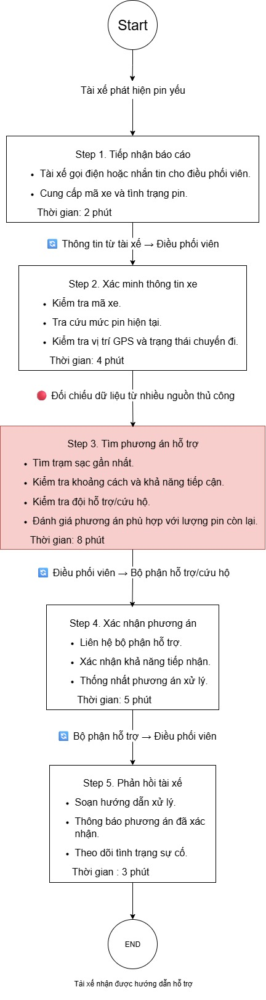
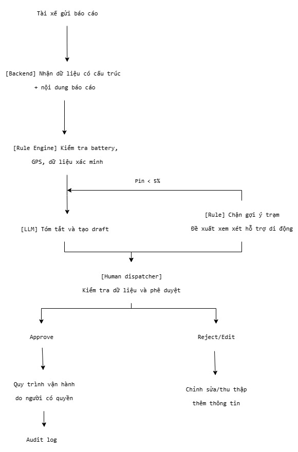

# Lab 02 — Worksheet: AI Product Scoping

# 🏗️ Phase 3 — DEEP-DIVE (Nhóm)

## 3.1. Current-State Workflow

**Tổng cộng = 22 phút/lượt**

## 3.2. Problem Statement (6-field)

| Field | Nội dung chi tiết |
|---|---|
| **1. Actor / Operator** | Điều phối viên Xanh SM tiếp nhận và xử lý báo cáo xe điện pin yếu từ tài xế. |
| **2. Current Workflow** | Tiếp nhận tin nhắn/cuộc gọi → hỏi thông tin xe, pin và vị trí → tra cứu trạm sạc/đội hỗ trợ → chọn phương án → trao đổi với bộ phận liên quan → soạn phản hồi và theo dõi. |
| **3. Bottleneck** | Thông tin đầu vào không đồng nhất; phải đối chiếu nhiều nguồn; nguy cơ đề xuất trạm sạc không phù hợp khi pin nguy cấp. |
| **4. Business Impact** | Có thể làm tăng thời gian xử lý sự cố, kéo dài thời gian gián đoạn hoạt động của xe, ảnh hưởng trải nghiệm tài xế/khách hàng và tăng tải cho điều phối viên. Cần thu thập log để định lượng chi phí thực tế. |
| **5. Success Metric** | Pilot đề xuất: giảm thời gian tạo bản nháp xuống dưới 2 phút; 100% tình huống pin <5% bị chặn gợi ý trạm sạc; 100% phản hồi ở trạng thái draft và cần người duyệt; tỷ lệ JSON hợp lệ ≥99% trên bộ test. Các ngưỡng là mục tiêu thử nghiệm, cần hiệu chỉnh theo baseline. |
| **6. Operational Boundary** | AI chỉ tóm tắt thông tin và tạo bản nháp. Không gửi tin nhắn, không điều xe, không đặt trạm, không tự xác nhận dữ liệu GPS/pin/trạm. Nếu pin <5%, backend rule phải chặn gợi ý trạm và đề xuất quy trình hỗ trợ di động để dispatcher xem xét. Nếu thiếu dữ liệu hoặc API lỗi, yêu cầu xác minh/thực hiện quy trình thủ công. Mọi hành động cần human approval. |

## 3.3. Future-State Flow & AI Fit

**AI-Fit Matrix**
| Phương án | Vai trò | Đánh giá |
|---|---|---|
| Rule / State Machine | Kiểm tra ngưỡng pin, dữ liệu bắt buộc, khoảng cách và điều kiện cho phép | **Bắt buộc** cho các quyết định an toàn có điều kiện rõ ràng |
| LLM Feature | Hiểu nội dung tự nhiên, trích xuất thông tin được cung cấp, tóm tắt và soạn bản nháp | Phù hợp để hỗ trợ dispatcher |
| Agentic Loop | Tự gọi công cụ, tự điều phối xe hoặc gửi tin | **Không phù hợp trong scope prototype** vì có rủi ro hành động ngoài đời thực |

**Future-State Flow**  

---

## 🏁 Kết luận từ buổi Lab
Dự án được đánh giá ở mức NOT YET vì mặc dù bài toán hỗ trợ điều phối viên xử lý sự cố xe điện pin yếu tại Xanh SM có tiềm năng ứng dụng AI, giải pháp vẫn cần thêm dữ liệu vận hành thực tế để xác lập baseline và chứng minh hiệu quả. LLM có thể hỗ trợ đọc hiểu báo cáo, tóm tắt sự cố và tạo bản nháp phản hồi, trong khi các quy tắc an toàn quan trọng như ngưỡng pin dưới 5% phải được kiểm soát bằng Rule-based code. Nhóm sẽ tiếp tục thử nghiệm prototype offline với dữ liệu giả lập hoặc đã ẩn danh, kiểm tra các tình huống adversarial và duy trì cơ chế Human-in-the-loop trước khi xem xét triển khai thực tế.